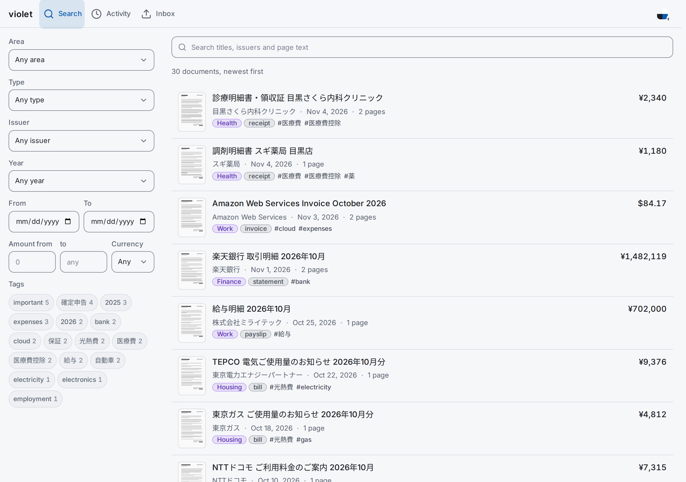

# violet

Reads, splits, names and files the documents dropped in a folder, and serves a search UI over them. Self-hosted.

[](https://github.com/DorskFR/violet/releases)
[](https://github.com/DorskFR/violet/actions/workflows/ci.yml)
[](LICENSE)

<picture>
  <source media="(prefers-color-scheme: dark)" srcset="docs/assets/screenshot-dark.png">
  
</picture>

PDFs, scans, photos, office files and emails go into `inbox/`. A vision model behind any OpenAI-compatible endpoint reads pages without a text layer, splits multi-document scans, and extracts title, issuer, date, tags and amounts; violet then files each document as `library/<Area>/<YYYY>/<YYYY-MM-DD> <Issuer> <Title>.pdf` next to a JSON sidecar.

## Features

- Text layer first, OCR only for image-only pages; Japanese era dates and yen amounts normalised.
- Split, merge, rotate and delete pages from the UI, the CLI or the model's own analysis.
- Every change is journaled; any of them can be undone from the Activity page.
- Plain files are the source of truth: `.index.sqlite` (full-text search, facets) is rebuilt from the sidecars with `violet reindex`.
- Works without a model: files are indexed by their text layer and filed under `Unsorted`.

## Quick start

```yaml
# compose.yaml
services:
  violet:
    image: ghcr.io/dorskfr/violet:0.1.4
    ports: ["8080:8080"]
    volumes: ["./docs:/library"]
    environment:
      VIOLET_VISION_URL: http://llama:8080/v1
      VIOLET_VISION_MODEL: qwen3-vl
```

```sh
docker compose up -d
cp ~/Downloads/*.pdf docs/inbox/
```

Open http://localhost:8080. Filed documents appear within seconds per text page; OCR takes longer per scanned page. Back up `./docs`.

## Configuration

| Variable | Default | Effect |
|---|---|---|
| `VIOLET_LIBRARY` | `/library` | Library root (`inbox/`, `library/`, journal, index) |
| `VIOLET_LISTEN` | `0.0.0.0:8080` | HTTP address |
| `VIOLET_VISION_URL` | unset | OpenAI-compatible base URL for OCR and analysis |
| `VIOLET_VISION_MODEL` | unset | Model name sent to that endpoint |
| `VIOLET_VISION_KEY` | unset | Bearer token, if the endpoint needs one |
| `VIOLET_TEXT_URL`, `_MODEL`, `_KEY` | vision values | Separate endpoint for the analysis step |
| `VIOLET_MODEL_TIMEOUT` | `600` | Seconds per model call |

Library layout: [crates/violet-core/src/library.rs](crates/violet-core/src/library.rs). HTTP API: [docs/api.md](docs/api.md).

## Usage

```sh
violet ingest scan.pdf            # file one document now
violet search 健康保険 --json      # full-text search
violet split <id> --groups 1-2,3  # split a document
violet undo <entry-id>            # revert a change
violet reanalyze --all            # redo metadata from stored text, no OCR
violet reindex                    # rebuild the index from sidecars
```

## Limitations

- OCR text is stored in sidecars and the index, not written back into the PDF as a selectable layer.
- Splitting drops outlines and form fields from the parts.
- Email bodies in charsets other than UTF-8 and ASCII are kept raw.
- Portrait pages are read in horizontal bands, which can break the reading order of vertical Japanese text.

## Development

```sh
git clone https://github.com/DorskFR/violet && cd violet
make test
make run   # server on :8080 over ./library
make dev   # UI on :5173, proxying /api
```

## License

[MIT](LICENSE)
